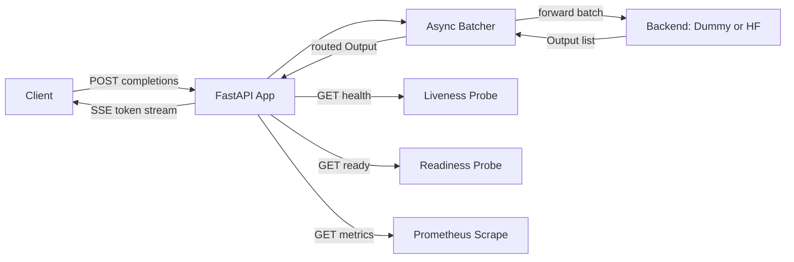

# mini-llm-serve

[](https://github.com/theraihanrakibb/mini-llm-serve/actions/workflows/ci.yml)
[](LICENSE)
[](https://www.python.org/downloads/release/python-3110/)

A tiny, self-contained **model inference server** — a minimal
[vLLM](https://github.com/vllm-project/vllm) / [Triton](https://github.com/triton-inference-server/server)
in a single package. It demonstrates the four pillars of production inference
serving — **dynamic batching**, **token streaming**, **health/readiness
probing**, and **Prometheus observability** — with zero GPU, zero large model
downloads, and a dependency-light stack that runs and is fully testable
anywhere.

> Perfect as a teaching artifact, a template for your own inference service, or
> a drop-in skeleton you swap a real backend into.

---

## Overview

`mini-serve` accepts prompts over HTTP, batches concurrent requests together,
runs them through a backend `forward` call, and streams tokens back to the
client via Server-Sent Events. Everything is observable: a `/metrics` endpoint
exposes queue depth, batch size, batching latency, token throughput and request
counts; `/health` and `/ready` give Kubernetes-style liveness/readiness probes.

The default `DummyBackend` is fully deterministic (outputs are derived from a
SHA-256 hash of the prompt), so the entire server — and its test suite — runs
on a CPU with no network access. Plugging in a real HuggingFace / PyTorch
backend is a ~20-line change (see [Plugging in a real backend](#plugging-in-a-real-backend)).

---

## Architecture



| Module | Responsibility |
| --- | --- |
| `mini_serve/server.py` | FastAPI app, route handlers, SSE streaming, config resolution |
| `mini_serve/batching.py` | Asyncio `Batcher`: coalesces requests into batched windows |
| `mini_serve/backends.py` | `Backend` ABC + deterministic `DummyBackend` |
| `mini_serve/metrics.py` | Prometheus counters/gauges/histograms |
| `mini_serve/schemas.py` | Pydantic HTTP models + internal `Request`/`Output` dataclasses |

---

## Quickstart

### Local (uvicorn)

```bash
python -m pip install -r requirements.txt
python -m uvicorn mini_serve.server:app --host 0.0.0.0 --port 8000
```

### Docker

```bash
docker build -t mini-serve .
docker run --rm -p 8000:8000 mini-serve
```

### Try it

```bash
# Non-streaming completion
curl -s -X POST http://localhost:8000/v1/completions \
  -H 'Content-Type: application/json' \
  -d '{"prompt":"hello world","max_tokens":5,"stream":false}'

# Streaming (SSE) completion
curl -N -X POST http://localhost:8000/v1/completions \
  -H 'Content-Type: application/json' \
  -d '{"prompt":"hello world","max_tokens":5,"stream":true}'

# Probes + metrics
curl -s http://localhost:8000/health
curl -s http://localhost:8000/ready
curl -s http://localhost:8000/metrics
```

### Configuration (env vars)

| Variable | Default | Meaning |
| --- | --- | --- |
| `MINI_SERVE_BACKEND` | `dummy` | Backend name (extend `build_backend`) |
| `MINI_SERVE_MAX_BATCH_SIZE` | `8` | Flush a batch once it reaches this size |
| `MINI_SERVE_MAX_WAIT_MS` | `20` | Max time to wait for a batch to fill |
| `MINI_SERVE_PORT` | `8000` | Port for `uvicorn` when run as `__main__` |

---

## API Reference

### `POST /v1/completions`

Request body (`application/json`):

```json
{
  "prompt": "hello world",
  "max_tokens": 5,
  "stream": false
}
```

* `prompt` *(string, required)* — input prompt.
* `max_tokens` *(int, 1–512, default 16)* — tokens to generate.
* `stream` *(bool, default false)* — when `true`, respond with
  `text/event-stream`.

**Non-streaming response** (`200`):

```json
{ "id": "a1b2c3...", "text": "hello_abc123 world_def456", "tokens": ["hello_abc123", "world_def456"] }
```

**Streaming response** (`text/event-stream`) — one `token` event per token,
then a final `done` event:

```
event: token
data: "hello_abc123"

event: token
data: "world_def456"

event: done
data: "[DONE]"
```

### `GET /health`

Liveness probe. Always returns `200 {"status":"ok"}` while the process is up.

### `GET /ready`

Readiness probe. Returns `200 {"status":"ready"}` only when the backend reports
ready; otherwise `503`.

### `GET /metrics`

Prometheus scrape endpoint exposing:

* `mini_serve_requests_total` — completed requests (by endpoint/status)
* `mini_serve_queue_length` — requests currently awaiting a batch flush
* `mini_serve_batch_size` — requests per backend `forward` call (histogram)
* `mini_serve_batching_latency_seconds` — backend `forward` latency (histogram)
* `mini_serve_tokens_per_second` — observed streaming throughput (gauge)

---

## Plugging in a real backend

Implement the `Backend` interface and register it in `build_backend` (or set
`MINI_SERVE_BACKEND`):

```python
# mini_serve/backends.py
from transformers import AutoModelForCausalLM, AutoTokenizer

class HfBackend(Backend):
    def __init__(self, model_name: str = "gpt2"):
        self.tokenizer = AutoTokenizer.from_pretrained(model_name)
        self.model = AutoModelForCausalLM.from_pretrained(model_name)
        self._ready = True

    async def ready(self) -> bool:
        return self._ready

    async def forward(self, batch: list[Request]) -> list[Output]:
        import torch
        prompts = [r.prompt for r in batch]
        enc = self.tokenizer(prompts, return_tensors="pt", padding=True)
        out = self.model.generate(**enc, max_new_tokens=batch[0].max_tokens)
        tokens = [self.tokenizer.decode(o, skip_special_tokens=True) for o in out]
        return [Output(request_id=r.id, tokens=[t]) for r, t in zip(batch, tokens)]
```

The `Batcher`, server, streaming, probes and metrics all work unchanged — that
is the whole point of the abstraction.

---

## Why this matters for AI infra

Inference serving has a different cost profile than training or classic web
serving, and `mini-serve` is a working microcosm of the techniques that make it
efficient and reliable at scale:

* **Throughput via dynamic batching.** GPUs are throughput monsters that are
  *underutilised* when serving one request at a time. Coalescing many concurrent
  requests into a single batched `forward` pass (bounded by `max_batch_size`
  and `max_wait_ms`) is the single highest-leverage optimisation in any inference
  server — it is the core idea behind vLLM, TensorRT-LLM and Triton.
* **Streaming UX via SSE.** Users perceive latency as *time-to-first-token*,
  not total time. Token-by-token Server-Sent Events make a 2-second generation
  feel responsive by delivering tokens as they are produced.
* **SLO probing.** `/health` (liveness) and `/ready` (readiness) are the
  primitives every orchestrator (Kubernetes, Nomad) uses for restarts, rollouts
  and traffic gating — separating "process is up" from "model is loaded".
* **Observability.** Queue length tells you if you are under-provisioned; batch
  size/histogram shows batching efficiency; batching latency isolates the
  backend; tokens/sec measures real throughput. Without these you are flying
  blind on a latency- and cost-sensitive service.

`mini-serve` is small enough to read in an afternoon yet faithful to the
architecture of systems that serve billions of tokens a day.

---

## Future work

* Real PyTorch / HuggingFace backend with KV-cache-aware continuous batching.
* Priority queueing and per-request `max_tokens` / timeout budgets.
* p99 batching-latency SLO alerts and Grafana dashboard JSON.
* Graceful shutdown that drains the in-flight batch.
* OpenAI-compatible `/v1/chat/completions` and structured (JSON) outputs.

---

## License

[MIT](LICENSE) © MD RAKIBUL ISLAM RAIHAN
